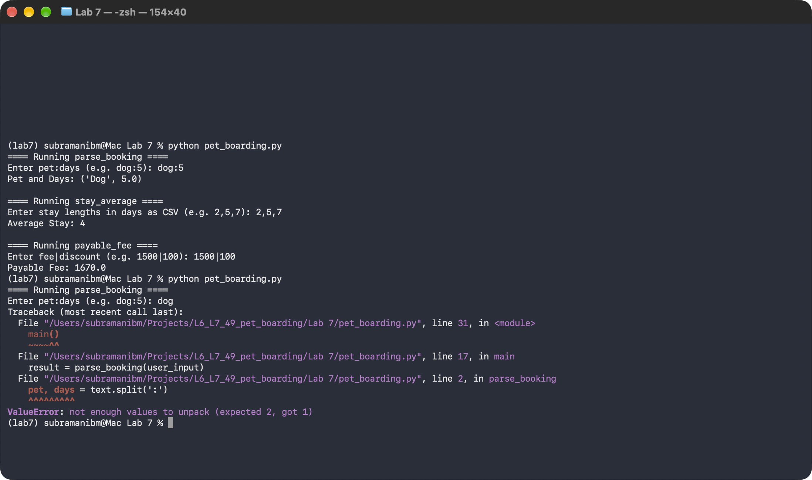
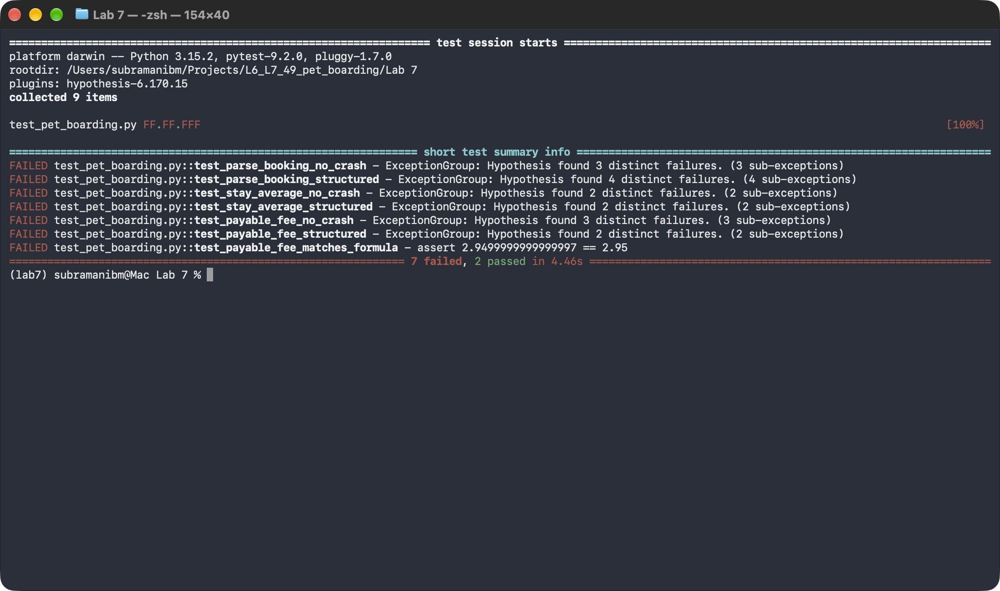
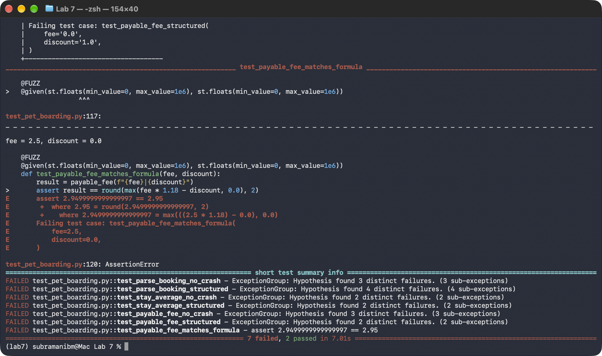
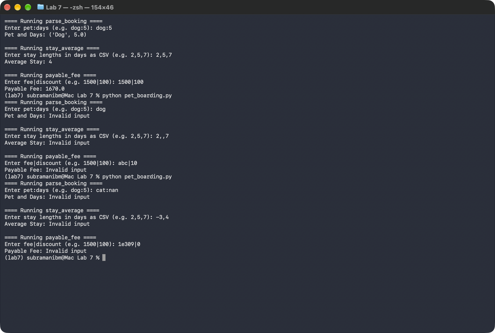
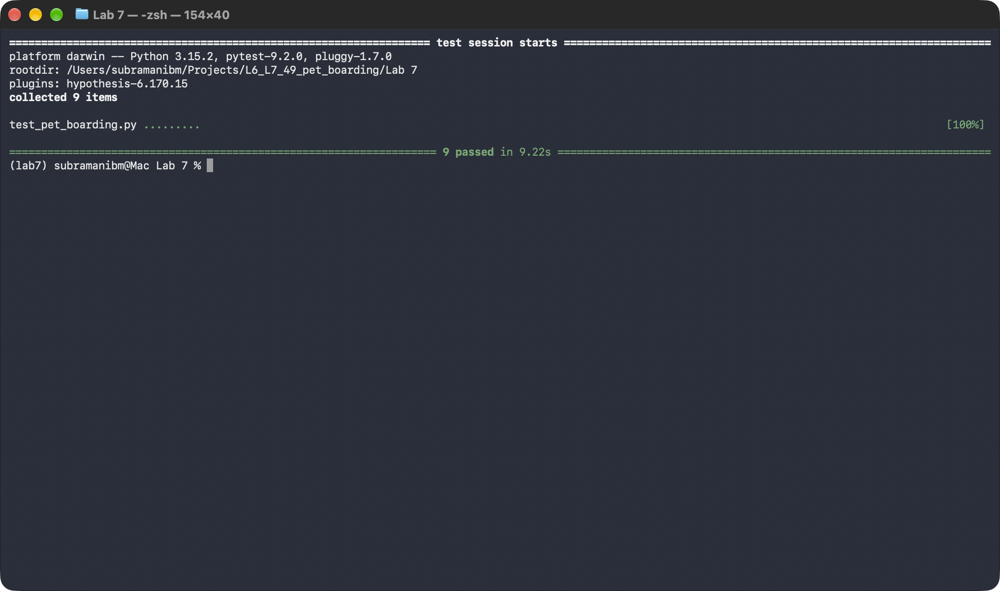

# 🐾 Lab 7: Fuzzing for Input Validation Bugs — Pet Boarding (#49)

**Course:** Software Engineering Lab — Department of Computer Science & Engineering, PES University  
**Student Name:** Subramani B M  
**SRN:** PES1UG24CS473  
**Section:** H  
**Assigned Repository:** [https://github.com/SETAPESU26/L6_L7_49_pet_boarding](https://github.com/SETAPESU26/L6_L7_49_pet_boarding)  
**Personal Solution Repository:** [https://github.com/SubramaniBM/L6_L7_49_pet_boarding](https://github.com/SubramaniBM/L6_L7_49_pet_boarding)  
**Main Lab Catalog:** [https://github.com/SubramaniBM/MyProject_MicroserviceCatalog](https://github.com/SubramaniBM/MyProject_MicroserviceCatalog)

---

## 📋 Lab 7 Deliverables

These follow the official [`Lab_7_FuzzTesting_Student_Handout.pdf`](Lab_7_FuzzTesting_Student_Handout.pdf). The repo names the files `pet_boarding.py` and `test_pet_boarding.py`; the handout calls them `processor.py` and `test_processor.py`.

| Deliverable | Description | File |
|:---|:---|:---:|
| **1. PDF report with screenshots** | All 6 steps, the bugs found, the fixes and the results. | [`Lab_7_Fuzz_Testing_Report_PES1UG24CS473.pdf`](Lab_7_Fuzz_Testing_Report_PES1UG24CS473.pdf) |
| **2. Fixed application script** | Hardened module: validates input and returns `None` instead of crashing. | [`pet_boarding.py`](pet_boarding.py) |
| **3. Updated test file** | 9 Hypothesis property tests (300 examples each). | [`test_pet_boarding.py`](test_pet_boarding.py) |
| Original buggy script | Unmodified starter code, kept for comparison. | [`pet_boarding_original.py`](pet_boarding_original.py) |
| Screenshots | Real Terminal captures of steps 2, 4, 5 and 6. | [`screenshots/`](screenshots/) |

---

## 📊 Results

| Run | Code | Result |
|:---|:---|:---:|
| `python pet_boarding.py` | buggy | crashes on `dog` (ValueError) |
| `python -m pytest test_pet_boarding.py` | buggy | **7 failed, 2 passed**: 17 distinct failures |
| `python pet_boarding.py` | fixed | valid input unchanged; bad input → `Invalid input` |
| `python -m pytest test_pet_boarding.py` | fixed | **9 passed** |

### Bugs found by fuzzing

| # | Function | Failing input | Original behaviour | Fix |
|:-:|:---|:---|:---|:---|
| 1 | all three | `None` | `AttributeError` on `.split` | Return `None` unless input is a `str` |
| 2 | `parse_booking` | `''`, `'a:b:c'` | `ValueError` while unpacking | Require exactly one `:` |
| 3 | `parse_booking` | `':'`, `'cat:abc'` | `ValueError` from `float()` | Safe number conversion |
| 4 | `parse_booking` | `':0.0'` | Accepts an empty pet name | Pet name must be non-empty |
| 5 | `parse_booking` | `'cat:nan'`, `'cat:-3'`, `'0:0.0'` | Returns nan / negative / zero days | Days must be finite and > 0 |
| 6 | `stay_average` | `''`, `'1,,2'` | `ValueError` from `int()` | Reject empty or non-integer fields |
| 7 | `stay_average` | `'0'`, `'-3,-5'` | Returns 0 or a negative average | Each stay must be a positive integer |
| 8 | `payable_fee` | `''`, `'a\|b\|c'` | `ValueError` while unpacking | Require exactly one `\|` |
| 9 | `payable_fee` | `'\|'`, `'0.0\|'` | `ValueError` from `float()` | Safe number conversion |
| 10 | `payable_fee` | `'nan\|0'`, `'inf\|inf'`, `'1e309\|0'` | Returns nan or inf | Reject non-finite values and overflowed totals |
| 11 | `payable_fee` | `'100\|-500'` | A negative discount raises the fee (618.0) | Fee and discount must be ≥ 0 |
| 12 | `payable_fee` | `'0.0\|1.0'`, `'2.5\|0'` | Returns int `0`; float noise `2.9499999999999997` | Always a float rounded to 2 decimals |
| 13 | `main` | closed stdin / Ctrl+C | `EOFError` / `KeyboardInterrupt` traceback | Caught; prints `Invalid input` for bad values |

### Fuzz tests (`test_pet_boarding.py`)

Contract: **never raise; return `None` for invalid input; any value returned must satisfy the function's invariants.**

| Function | No-crash test (`st.text() \| st.none()`) | Structured fuzz test | Correctness property |
|:---|:---|:---|:---|
| `parse_booking` | `test_parse_booking_no_crash` | `test_parse_booking_structured`: pet text + floats as text (nan, inf, negatives) | `test_parse_booking_accepts_valid_input` |
| `stay_average` | `test_stay_average_no_crash` | `test_stay_average_structured`: integers / random text joined by commas | `test_stay_average_within_bounds` |
| `payable_fee` | `test_payable_fee_no_crash` | `test_payable_fee_structured`: floats as text or random text around `\|` | `test_payable_fee_matches_formula` |

---

## 🖼️ Screenshots

**Step 2: buggy program**  


**Step 4: fuzz tests failing on the buggy code**  



**Step 5: fixed program**  


**Step 6: fuzz tests passing on the fixed code**  


---

## ▶️ Reproducing

```bash
pip install hypothesis pytest
python pet_boarding.py
python -m pytest test_pet_boarding.py
```
